# MolecWire architecture proposal

Date: 2026-10-27. Status: review proposal, not implemented. Product scope is in [PROJECT.md](../PROJECT.md); evidence is in [technology-comparison.md](technology-comparison.md). Source inspection establishes conventions, not operational success.

## 1. Decisions and tradeoffs

Use a **Go modular monolith with PostgreSQL**, with API and worker entrypoints sharing domain/application packages. This keeps publication, approval and provenance transactions local while allowing ingestion and model calls to run outside HTTP requests. A service split is justified later only by measured scaling, ownership or isolation needs. The public site and newsroom are clients of the same publishing rules.

| Area | Proposal for review | Basis and limits |
|---|---|---|
| Backend | Go; pin a supported toolchain during foundation | Both references use Go; their declared toolchain versions are observations, not a requirement to copy the newest version |
| Router | Kapsora's chi pattern is the leading candidate; standard ServeMux remains a valid smaller alternative | Kapsora has composed middleware/domain routes; BioExamine uses standard mux. Final choice at architecture review |
| Database | PostgreSQL with pgx; sqlc and golang-migrate are leading query/migration candidates | pgx shared by both; Kapsora demonstrates generated queries and migration runner. Do not copy either schema |
| Structure | Domain modules, explicit composition roots, application services called by HTTP handlers and workers | Compatible with both repositories' direction; avoid Kapsora's unrelated healthcare/finance breadth and BioExamine's development slice |
| Newsroom | React/TypeScript with Vite is the reference-aligned candidate | Both use it. Do not assume a Vite SPA alone solves public SEO; choose public server rendering during foundation review, without defaulting to Next.js |
| Authentication | Server-side opaque sessions, secure cookies, CSRF protection and server-side roles; local-password versus external identity remains open | Actual session patterns in both references; avoid copying their business identity model |
| Jobs | PostgreSQL durable jobs and transactional outbox, at-least-once handlers | Kapsora supplies implemented patterns; BioExamine's separate worker is idle |
| Cache/search | PostgreSQL search initially; bounded local cache only for measured needs | No default Redis or external search cluster; cache is never the authorization source |
| Storage | Private S3-compatible storage if permitted raw material/attachments require it | Kapsora has an adapter; retention and deployment provider are unresolved |
| Observability | JSON slog with request/job identifiers; metrics and operational alerts | Both use slog; never log whole email bodies, credentials or prompts by default |
| AI | Narrow Go provider adapter, validated structured responses | No demonstrated indispensable Python-only requirement; no Python service proposed |
| Deployment | API and worker processes, PostgreSQL, optional private storage behind TLS | Kapsora has systemd/proxy assets; actual MolecWire hosting and CI deployment credentials remain unselected |

Reuse patterns, not unrelated source code. Tenant isolation is not an established MolecWire product requirement. Define newsroom RBAC first; choose PostgreSQL RLS only with an explicit isolation model and tests, rather than copying the reference tenant/subject policies. Avoid Kubernetes, microservices and a standalone scheduler until requirements justify them.

## 2. Proposed repository structure and ownership

This tree is a proposal only; no directories below are application scaffolding in this change.

```text
cmd/api/                         # HTTP composition root
cmd/worker/                      # durable handlers and periodic enqueueing
internal/
  sources/                       # catalog, permission policies and review dates
  ingestion/                     # feed/API/email/manual adapters, normalization
  stories/                       # clusters, claims and evidence assessments
  editorial/                     # immutable revisions, review decisions
  publishing/                    # publication pointer, public queries, notices
  ai/                            # provider adapter, templates and evaluations
  identity/                      # users, sessions and role enforcement
  operations/                    # schedules, failures, audit and cost reporting
  platform/{database,queue,storage,http,observability}/
migrations/                      # one ordered schema history
web/                             # newsroom and selected public frontend
tests/                           # cross-module and workflow verification
deploy/                          # chosen environment assets after review
docs/
```

Keep domain logic independent from HTTP and provider SDKs. Add application/transport/infrastructure subpackages when a module benefits from them, not as empty boilerplate. Modules own writes to their tables; cross-module operations go through application services with explicit transactions. Platform code cannot decide editorial readiness.

## 3. Information flow and editorial state

```mermaid
flowchart LR
  S[Source discovery and permission review] --> I[RSS / API / email / manual intake]
  I --> Q[Quarantine and normalize]
  Q --> D[Deduplicate and cluster]
  D --> E[Claims and evidence assessment]
  E --> A[AI-assisted or manual draft]
  A --> H[Human review of exact revision]
  H --> P[Publication transaction and outbox]
  P --> W[Public pages / feeds / search]
  W --> C[Monitor / correct / retract]
  C --> E
```



1. **Discover:** editors nominate official/primary and relevant secondary sources. Record owner, canonical URL, rights basis, allowed acquisition modes, permitted uses, expiry/review date, retention and rate limits. Discovery is not permission to fetch. Unapproved, suspended or expired policies block retrieval and generation until reviewed. RSS availability and robots rules alone do not establish republication rights.
2. **Ingest:** RSS/Atom and contracted APIs first; allowlisted pages only with an approved policy. Deduplicate by source and stable external identifier, with canonical URLs and hashes as additional signals. Record retrieval/publication times, publisher, author when available and original language. Manual entry receives identical provenance requirements.
3. **Email:** a configured dedicated address uses an authenticated provider webhook or approved mailbox adapter. Verify signature/replay window, bound MIME depth and size, quarantine attachments and scan before extraction. Block executable content/macros; extraction has no arbitrary network access. Record sender authentication separately from claim credibility. Keep recipients and private contact information out of public content.
4. **Normalize:** sanitize markup; retain permitted immutable source versions and content hashes. A changed source creates a new version. Do not erase earlier evidence silently. Keep attachment metadata and evidence identifiers even if rights require raw-content expiry, with an explicit unavailable-evidence marker.
5. **Deduplicate/cluster:** exact duplicate handling is idempotent. Similarity suggests a cluster but does not merge claims automatically. Editors can split/merge clusters with an audit trail. Syndicated copies share an origin and do not count as independent confirmation.
6. **Assess:** extract claims and link each to supporting, contradicting or contextual evidence with locators. Keep source credibility, corroboration, completeness and readiness separate, each with rationale and actor/version. Label single-source reports, uncertainty, conflict and stale evidence. A primary press release is evidence of an attributed announcement, not independent proof of all its claims.
7. **Draft:** produce original synthesis linked to evidence IDs. Distinguish fact, attributed assertion, inference, analysis and sponsorship. Quotes require verified text/locator and permitted use. An unsupported claim must be explicitly flagged for the editor; model confidence cannot establish truth.
8. **Review:** draft -> in_review -> approved or changes_requested/rejected. Decisions bind an immutable revision ID and locale. New edits create a new revision and invalidate approval for that replacement. All MVP publications and translations require human approval, including low-risk material. Whether author and approver must be different people is a product decision; approval cannot be delegated to the model.
9. **Publish:** authorize the actor and check revision approval, readiness and optimistic version in one transaction; update the published pointer and insert outbox events atomically. A draft/review/approved revision alone is never public. Use stable article IDs and locale URLs; feeds and search read only published pointers.
10. **Monitor:** source updates or conflicting evidence open review tasks rather than rewriting published content automatically. A correction creates an approved replacement and public notice linking the affected revision. Authorized retraction suppresses normal distribution, retains an appropriate notice and emits removal/invalidation events; emergency withdrawal must not wait for an AI run. Preserve reasons and actor history. Define response targets before launch.

## 4. Conceptual PostgreSQL model

This is a relational design proposal, not executable DDL. Use foreign keys, UTC timestamps, immutable identifiers, bounded text fields and explicit concurrency versions. Index access paths after representative workloads exist.

| Entities | Relationships and important constraints |
|---|---|
| users, roles, user_roles, sessions | User-to-role membership; hashed opaque session token; expiry/revocation; roles checked server-side |
| sources, source_policies | Source has versioned rights/retrieval/retention policies; source items identify the policy used at acquisition |
| source_items, source_item_versions | Unique `(source_id, external_id)` where present; item has immutable versions with hash, URL/message provenance, language and timestamps |
| email_submissions, attachments | Provider delivery identifier unique; links to resulting source item; attachment quarantine/scan status and private object key |
| story_clusters, cluster_items | Many-to-many item membership; merge/split decisions retained |
| claims, evidence_links, claim_assessments | Claim-to-source-version evidence with relation and locator; versioned assessments record author/model and rationale; track shared reporting origin |
| articles, article_revisions, revision_claims | Stable article identity; immutable content/locale revision; revision-to-claim joins identify evidence used |
| editorial_decisions | Exact revision, decision, actor, rationale and time; append decisions, do not mutate history |
| publications, translations | Unique article/locale publication pointer to an approved revision; translation references the exact original revision and becomes stale when that source changes |
| corrections, retractions | Affected/replacement revision, reason, actor and public notice; replacement requires approval, withdrawal is an authorized audited action |
| categories, tags, article_categories, article_tags | Controlled editorial taxonomy; public queries apply publication visibility |
| ai_runs | Model/provider identifier, prompt-template version, evidence IDs, validation result, latency, token/cost metadata; retention-controlled payload references |
| jobs, outbox_events | Unique idempotency keys; payload schema/version, available_at, lease, attempts and terminal error; publication event belongs to its committing transaction |
| audit_events | Actor/service, action, target ID, request/job ID and time; append-only application permissions; avoid secrets/raw sensitive content |

Approval/publication referential constraints must prevent pointing to a revision of a different article or locale. Concurrent publish/edit actions cannot authorize a stale replacement. Database constraints and application tests jointly enforce this invariant. Audit immutability is an access-control goal, not a claim of cryptographic tamper proofing; retention/deletion requirements must be reconciled before launch.

## 5. Reliability and deployment

Durable workers claim ready jobs with PostgreSQL locking, bounded concurrency and expiring leases. Heartbeats or conservative lease lengths protect long model calls. Recover expired leases, retry transient failures with bounded exponential backoff and jitter, and expose dead-letter review/replay. Delivery is **at least once**: a crash after an external side effect but before acknowledgement can redeliver. Use stable operation keys and deduplicated consumers; do not promise exactly-once provider calls or charges.

Commit item creation and downstream work together. Use unique scheduled occurrence keys and a database lock when multiple worker processes enqueue periodic jobs. Fetch timeout, byte limits, per-source rate limits, provider quotas and circuit breakers prevent one source from exhausting the system. A model outage leaves evidence and drafts available for manual work.

Run migrations once as a deployment step, not concurrently in every replica. Prefer additive schema changes and verified rollback/restore procedures. Separate readiness (database and essential dependencies) from process liveness; gracefully stop accepting work and release/recover leases on shutdown. Pin dependencies and verify toolchain/library choices at implementation time.

Start with a small deployment using TLS, least-privilege database/object-store accounts, secret injection, encrypted backups and private storage. The hosting provider, process manager and object-store location require confirmation; Kapsora's systemd assets show a candidate pattern, not an approved MolecWire deployment. Establish backup retention, RPO/RTO and an actual restore drill before launch.

## 6. Trust boundaries and quality gates

| Boundary / failure | Required control and verification |
|---|---|
| Fetcher to external network | Allowlisted schemes/hosts; reject internal/private/link-local destinations, validate resolved addresses and every redirect, defend DNS rebinding; bounded time/size; SSRF fixtures |
| HTML/email/attachments to extraction | Sanitization, MIME/type/size limits, quarantine/scanning, isolated extraction, no automatic remote-image fetching; malicious payload fixtures |
| Source text to AI | Treat documents as untrusted data, separate instructions, minimize evidence context; no arbitrary tools, network or publisher credentials; structured schema validation and injection evaluations |
| AI output to editorial content | Resolve citations only against supplied evidence IDs, verify quotes and numerical claims, flag unsupported/conflicting material; editor remains accountable |
| Session to protected operation | Secure HttpOnly cookies, CSRF, session rotation/revocation, login limiting and server-side role checks; negative authorization tests |
| Draft to public channel | Exact revision approval and transaction checks; search/feed/cache cannot expose drafts; race and visibility tests |
| Licensed source to storage/publication | Policy checks before retrieval/use; limited quotation/original synthesis; retention expiry and takedown process; legal/contract terms reviewed by responsible owner |
| Operations to sensitive data | Redacted structured logs, least privilege, audit access controls and retention policies; no full prompts/email bodies by default |

Prompt separation alone cannot eliminate injection. A compromised model response must still lack capabilities to fetch arbitrary URLs, change permissions or publish. No quantitative accuracy claim is made before evaluation.

Track ingestion lag/failures, duplicate rate, evidence coverage, editor review effort, unsupported/corrected claims, queue age, publish errors, model latency/cost and correction response time. Use representative normal, conflicting, multilingual and adversarial fixtures; define owner-approved thresholds before launch. CI should cover formatting, lint/vet, unit/race tests, PostgreSQL migrations and integration invariants, contract checks, frontend build and critical workflow checks. Tests and deployment health of reference projects were not established by this discovery.
